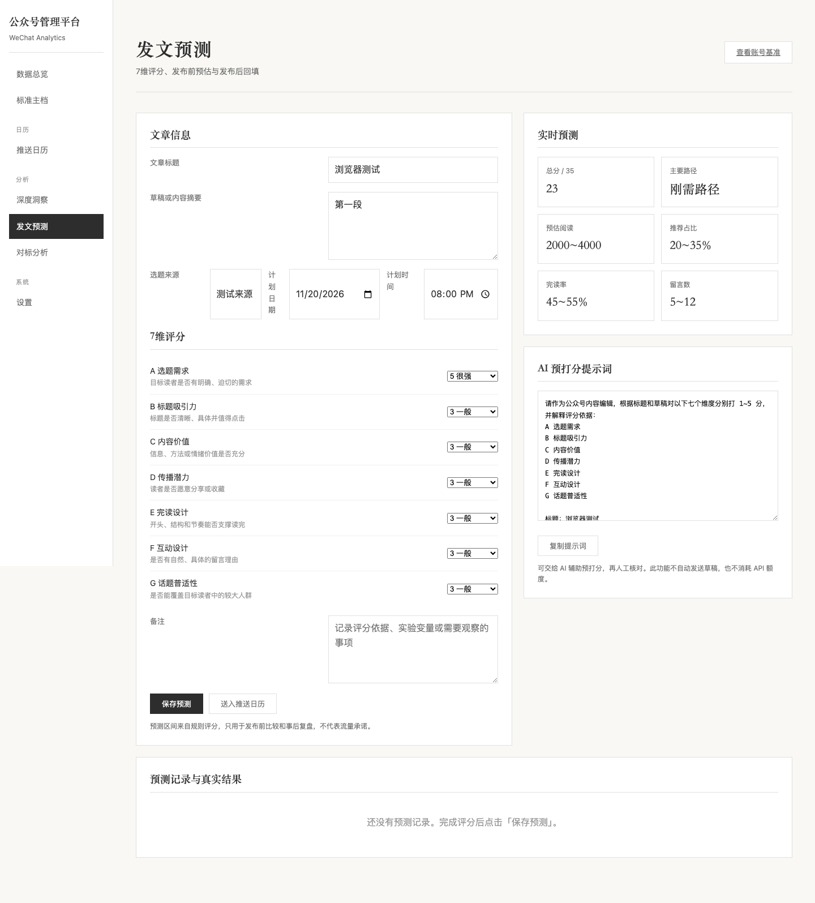

# 公众号数据平台

一个本地优先的微信公众号数据分析与内容运营平台。把微信公众平台导出的 XLS 数据统一导入 SQLite，通过 Web 页面查看文章表现、账号趋势和内容洞察，并配合 Chrome 扩展批量获取单篇文章的详情数据。

平台包含数据导入、文章诊断、深度洞察、推送日历、发文预测、账号基准和对标账号分析。数据与凭证默认保存在自己的电脑上，不需要把公众号数据上传到第三方平台。



## 功能

| 模块 | 页面 | 功能 |
| --- | --- | --- |
| 数据总览 | `/` | 总阅读量、粉丝、发文数量、最近导入记录 |
| 标准主档 | `/master` | 文章总表、文章诊断、账号趋势、异常记录和人工修正 |
| 文章详情 | `/article/<title>` | 阅读趋势、流量渠道、阅读后关注和详细指标 |
| 深度洞察 | `/insights` | 标题长度、生命周期、发文频率、涨粉归因、节假日和传播力分析 |
| 推送日历 | `/push-calendar` | 月/年/时间线视图、拖拽、批量操作、重复事件、多日历、回收站和导入导出 |
| 数据管理 | `/data` | 上传 XLS、查看导入批次、按范围删除、导出数据库和 CSV |
| 发文预测 | `/predict` | 七维选题评分、预测指标、AI 预打分提示词、保存记录和事后回填真实表现 |
| 账号基准 | `/baseline` | 根据历史文章计算平均阅读、推荐占比、完读率和爆文门槛 |
| 对标分析 | `/competitor` | 导入对标文章 CSV、对比数据、AI 分析和标题改写建议 |
| 设置 | `/settings` | 微信凭证、Bark、SMTP 邮件、定时任务和异常阈值 |

Chrome 扩展提供：

- 自动识别微信后台 Token 和 Fingerprint；
- 将 Token、Fingerprint 和 Cookies 同步到本地平台；
- 按文章发布日期筛选并批量下载详情文件；
- 只补缺失详情，或重新更新指定范围内的全部文章；
- 批量抓取已进入分析流程的对标文章正文。

完整的插件安装与使用说明见 [chrome_extension/README.md](chrome_extension/README.md)。

## 技术栈

- Python 3、Flask、SQLite、Jinja2
- Chart.js、原生 JavaScript
- Chrome Extension Manifest V3
- APScheduler、jieba、xlrd
- 可选：Docker、Anthropic API、Bark、SMTP

## 快速开始

### 1. 获取代码

```bash
git clone https://github.com/tz77ykx/wechat-data-platform.git
cd wechat-data-platform
```

### 2. 安装并启动

建议使用 Python 3.10 或更高版本，并使用虚拟环境：

```bash
python3 -m venv .venv
source .venv/bin/activate
pip install -r requirements.txt
python app.py
```

Windows PowerShell 激活虚拟环境的命令为：

```powershell
.venv\Scripts\Activate.ps1
```

启动后打开 <http://localhost:5001>。首次启动会自动创建空的 `wechat_master.db`，仓库不包含任何真实公众号数据。

### 3. 导入数据

在「数据管理」页拖拽上传微信公众平台导出的 XLS 文件，或把文件放入自动监控目录：

```text
~/Downloads/Chrome_Downloads/
```

平台每 20 秒扫描一次。监控目录可通过环境变量修改：

```bash
export DOWNLOADS_DIR="/你的下载目录"
python app.py
```

支持以下文件：

| 文件 | 内容 |
| --- | --- |
| `tendency_*.xls` | 账号数据趋势 |
| `user_analysis.xls` | 用户增减 |
| `menu_analysis.xls` | 菜单数据 |
| `message_analysis.xls` | 消息数据 |
| `数据明细*.xls` | 单篇文章详情、阅读趋势和渠道分布 |

导入历史按文件名记录，同一文件不会重复导入。旧版「阅读后关注」和新版「新增关注」详情格式均可解析。

## Chrome 扩展：安装与使用

扩展位于 `chrome_extension/`，无需单独安装 npm 依赖。

### 安装

1. 先启动本地平台，确认 <http://localhost:5001> 可以打开。
2. 在 Chrome 中打开 `chrome://extensions/`。
3. 打开右上角「开发者模式」。
4. 点击「加载已解压的扩展程序」。
5. 选择本项目中的 `chrome_extension` 目录。
6. 建议点击浏览器工具栏的扩展图标，将「公众号助手」固定到工具栏。

### 同步微信凭证

1. 在同一浏览器登录 [微信公众平台](https://mp.weixin.qq.com/)。
2. 打开微信后台任意数据页面，让扩展捕获 Token 和 Fingerprint。
3. 点击「公众号助手」扩展图标。
4. 确认 Token、Fingerprint 和 Cookies 已被检测到。
5. 点击「一键同步到本地工具」。

凭证只发送到 `http://localhost:5001`，并保存在本地 SQLite 数据库中。Token 通常约两小时后过期；变黄或失效后，重新打开微信后台并再次同步。

### 批量下载单篇详情

1. 保持本地平台运行，并先完成凭证同步。
2. 在扩展中选择「文章发布日期」：最近 7、30、90 天或自定义起止日期。
3. 选择下载方式：
   - **只补未导入详情的文章**：适合日常补齐新文章；
   - **重新更新范围内的全部文章**：适合跟踪近期文章后续增长。
4. 点击「开始批量下载」。
5. 等待扩展逐篇打开详情页并下载 XLS。任务由扩展后台执行，关闭弹窗不会中断。
6. 下载完成后，文件会由平台自动识别并导入；也可以到「数据管理」页手动上传。

日期范围筛选的是**文章发布日期**，包含起止当天，不会裁剪详情文件内的统计日期。浏览器下载目录应与 `DOWNLOADS_DIR` 一致；如果不一致，请设置环境变量或手动上传。

更新扩展代码后，在 `chrome://extensions/` 中点击「重新加载」。如果平台接口也有更新，同时重启 Flask 服务。

## 日常使用流程

1. 启动平台并登录微信公众平台。
2. 通过扩展同步凭证，批量下载新文章或近期文章的详情。
3. 导入账号趋势、用户增减等汇总 XLS。
4. 在「标准主档」和「深度洞察」中检查文章与账号表现。
5. 在「推送日历」中安排后续选题和发布计划。
6. 可选：在「设置」中配置 Bark、邮件日报和异常告警。

「阅读后关注／新增关注」是单篇文章的归因指标，跨文章求和不等于账号净涨粉；账号净涨粉应以用户增减报表为准。

## 对标分析与 AI 配置

「对标分析」页支持上传一个或多个 CSV。字段包括公众号名称、标题、链接、发布时间、点赞、阅读、分享和留言；平台会整理并去重。

AI 分析是可选功能。需要 Anthropic API Key 时，可在「设置」页填写，或在启动前设置环境变量：

```bash
export ANTHROPIC_API_KEY="你的 API Key"
# 可选：使用兼容的自定义接口地址
export ANTHROPIC_BASE_URL="https://api.anthropic.com"
python app.py
```

通过设置页填写的 Key 只保存在当前进程内，重启后需要重新填写。不要把真实 Key 写入代码、提交到 Git 或上传到 Issue。

发文预测当前使用规则评分。只有积累足够的「评分 + 真实结果」记录后，才适合进一步校准权重；不要把规则评分理解为已训练模型的保证。

## 配置项

| 环境变量 | 默认值 | 用途 |
| --- | --- | --- |
| `MASTER_DB_PATH` | 项目目录下 `wechat_master.db` | 主数据库路径 |
| `DB_PATH` | 与 `MASTER_DB_PATH` 相同 | 兼容数据库路径 |
| `DOWNLOADS_DIR` | `~/Downloads/Chrome_Downloads` | 自动导入监控目录 |
| `COMPETITOR_IMPORT_DIR` | 项目目录下 `对标账号/` | 本地对标 CSV 扫描目录 |
| `ANTHROPIC_API_KEY` | 空 | 可选 AI 对标分析 |
| `ANTHROPIC_BASE_URL` | `https://api.anthropic.com` | 可选 AI 接口地址 |

## Docker 部署

```bash
mkdir -p data uploads
docker compose up -d --build
```

打开 <http://localhost:5001>。数据库保存在 `./data/wechat_master.db`，上传文件保存在 `./uploads/`。

停止服务：

```bash
docker compose down
```

## macOS 开机启动

`setup_mac.sh` 会创建虚拟环境、安装依赖，并注册 LaunchAgent：

```bash
bash setup_mac.sh
```

默认打开 <http://localhost:5001>。如需自定义自动导入目录：

```bash
DOWNLOADS_DIR="$HOME/Downloads/Chrome_Downloads" bash setup_mac.sh
```

卸载或修改 LaunchAgent 前，请先确认对应服务配置；日常使用通常直接运行 `python app.py` 即可。

## 数据备份

备份时至少需要保留：

- `wechat_master.db`，或 Docker 模式下的 `data/wechat_master.db`；
- 需要保留原始导出文件时，同时备份 `uploads/`；
- 推送日历保存在浏览器 `localStorage`，需要在日历页面单独导出。

数据库包含公众号运营数据、微信凭证、Bark Key 和 SMTP 配置，不要提交到公开仓库。

## 测试

Python 测试：

```bash
python -m unittest discover -s tests
```

Chrome 扩展 JavaScript 测试需要 Node.js：

```bash
node --test tests/test_*.js
```

## 项目结构

```text
.
├── app.py                  # Flask 入口
├── config.py               # 路径和运行配置
├── core/                   # 数据库、解析、监控、通知、AI 等业务逻辑
├── routes/                 # 页面与 API Blueprint
├── templates/              # Jinja2 页面
├── static/                 # CSS、JavaScript、图标和 Service Worker
├── chrome_extension/       # Chrome 扩展完整源码与使用说明
├── tests/                  # Python 与扩展测试
├── tools/                  # 历史数据库迁移工具
├── Dockerfile
└── docker-compose.yml
```

## 安全与使用边界

- 当前应用没有登录鉴权，并默认监听所有网卡。**建议只在本机或可信内网使用，不要直接暴露到公网。**
- 微信 Cookie、Token 和 API Key 都属于敏感信息，请定期检查数据库与日志的访问权限。
- 微信公众平台页面和接口可能变化，自动下载功能可能需要随平台更新。
- 请遵守微信公众平台规则，控制访问频率，只处理自己有权访问的数据。
- 对标文章内容版权归原作者所有；分析和改写不等于可以复制原文。

## 已知限制

- 推送日历数据默认仅保存在当前浏览器，不跨设备同步。
- 单篇详情需要逐篇下载，可能受到微信后台页面变化或反自动化限制。
- 定时下载使用 macOS 的 `open` 命令，其他系统建议手动下载或使用扩展。
- 新增专有名词可加入 `core/user_dict.txt`，改善 jieba 标题分词。

## 许可证

本项目采用 [MIT License](LICENSE)。允许使用、修改、分发和商用，但必须保留原作者的版权与许可声明。软件按“现状”提供，不附带任何担保。
